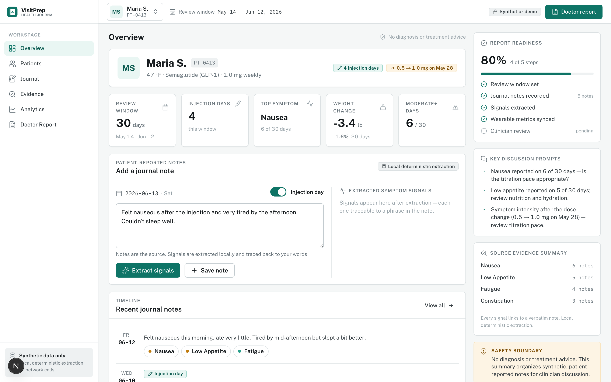

# VisitPrep

[](https://github.com/shubhampareek1211/visitprep-health-journal/actions/workflows/ci.yml)

VisitPrep is a personal project exploring how free-text health journal entries and wearable-style measurements can be organized into traceable symptom signals, trends, and a concise visit summary.

The application demonstrates a source-first pipeline:

```text
journal entry → extracted signals → analytics → saved report snapshot
```

It currently uses synthetic GLP-1 journal data. Signal extraction is deterministic and runs on the application server. Every signal keeps its matched text and evidence span so a reader can inspect where a summary came from.



## Features

- Synthetic patient workspaces with separate, expiring sessions.
- Server-side symptom extraction with assertion, severity, and evidence spans.
- Journal entry validation, transactional persistence, and idempotent retries.
- Rolling-window analytics with distinct symptom-day counts and missing wearable data represented explicitly.
- Revision-checked, immutable report snapshots with source-note evidence.
- Same-origin API routes, request limits, health checks, request IDs, and expired-session cleanup.
- PostgreSQL migrations, automated tests, and GitHub Actions CI.

## Technology

- Next.js App Router, React, and TypeScript
- PostgreSQL 16 or newer, Drizzle ORM, and Drizzle Kit
- Vitest for unit and database integration tests
- Deterministic TypeScript NLP rules; no external AI API is used

## Requirements

- Node.js 22.x and npm
- PostgreSQL 16+

## Run locally

1. Clone the repository and install dependencies:

   ```bash
   git clone https://github.com/shubhampareek1211/visitprep-health-journal.git
   cd visitprep-health-journal
   npm ci
   ```

2. Create local development and test databases. For a local PostgreSQL installation, for example:

   ```bash
   createdb visitprep_dev
   createdb visitprep_test
   ```

3. Copy `.env.example` to `.env.local` and set the database URLs and a random cron secret. A typical local setup is:

   ```dotenv
   DATABASE_URL=postgres://localhost/visitprep_dev
   TEST_DATABASE_URL=postgres://localhost/visitprep_test
   CRON_SECRET=replace-with-a-long-random-secret
   ```

   Use credentials and connection strings appropriate for your PostgreSQL installation. Keep `.env.local` private; it is ignored by Git.

4. Apply the database migration and start the development server:

   ```bash
   npm run db:migrate
   npm run dev
   ```

   Visit [http://localhost:3000](http://localhost:3000). The first visit creates an isolated synthetic workspace. The app does not automatically create a missing database; create it before migrating.

## Common commands

```bash
npm run dev           # Start the local development server
npm run build         # Create a production build
npm run start         # Serve a production build
npm run lint          # Run ESLint
npm run typecheck     # Run TypeScript checks
npm test              # Run unit and configured integration tests
npm run nlp:evaluate  # Evaluate extraction on the curated synthetic set
npm run db:generate   # Generate a migration from schema changes
npm run db:migrate    # Apply pending database migrations
```

To run the PostgreSQL integration tests, configure `TEST_DATABASE_URL` to point to a **disposable test database**. The tests create and remove synthetic workspaces. Apply migrations to that database first:

```bash
DATABASE_URL="$TEST_DATABASE_URL" npm run db:migrate
npm test
```

Never point the test database setting at production.

## Project layout

```text
src/app/                 Next.js pages and API routes
src/components/          Workspace and design-system components
src/lib/nlp/             Symptom dictionary and deterministic extraction
src/lib/server/          Database schema, contracts, and repository services
src/lib/analytics/       Analytics helpers and tests
src/types/               Shared domain types
data/synthetic/          Synthetic journal dataset
drizzle/                 Versioned PostgreSQL migrations
scripts/                 NLP evaluation tooling
design-system/           UI tokens and component references
docs/screenshots/        Application screenshots
```

## API overview

The versioned API is under `/api/v1`:

| Endpoint | Purpose |
| --- | --- |
| `POST /api/v1/demo-sessions` | Start or resume a synthetic demo session |
| `GET /api/v1/workspace` | List patients in the current workspace |
| `GET /api/v1/patients/:id` | Fetch a patient view and analytics |
| `POST /api/v1/patients/:id/journal-entries` | Save a journal entry |
| `POST /api/v1/extractions/preview` | Preview extracted signals without saving |
| `POST /api/v1/patients/:id/reports` | Create or return a report snapshot |
| `GET /api/v1/reports/:id` | Fetch a saved report snapshot |

Operational endpoints: `/api/health/live` reports process availability, `/api/health/ready` checks database connectivity, and `/api/internal/cleanup` removes expired workspaces when called with the configured cron authorization header.

## Continuous integration

GitHub Actions runs on pushes and pull requests. It provisions PostgreSQL, installs the lockfile with `npm ci`, applies migrations, and runs lint, type checking, unit and integration tests, the NLP evaluation, and a production build.

Before opening a pull request, run:

```bash
npm run lint
npm run typecheck
TEST_DATABASE_URL=postgres://... npm test
npm run nlp:evaluate
npm run build
```

For repository maintainers: require the `verify` workflow to pass in branch protection before merging to `main`. Dependabot keeps npm packages and GitHub Actions dependencies under review.

## Deployment notes

The repository includes a daily cleanup schedule for Vercel in `vercel.json`. A hosted deployment also needs a managed PostgreSQL database, `DATABASE_URL`, and a strong `CRON_SECRET`. Apply migrations as a controlled deployment step before serving code that depends on them. Configure edge rate limits for unauthenticated session creation and verify backup, restore, monitoring, and rollback procedures with your hosting provider.

The repository does not include hosting credentials or provision cloud infrastructure. Configure a deployment target and its required secrets in that provider before enabling automatic production deploys.

## Evaluation and limitations

The evaluator checks the curated synthetic dataset for symptom labels, severity, injection context, and evidence spans:

```bash
npm run nlp:evaluate
```

The rules were developed against synthetic examples, so perfect results on this dataset do not show that extraction generalizes to real clinical text. Broader evaluation needs independently annotated data and careful review. This application is an educational software project, not a medical device or clinical decision support system. It does not diagnose, recommend treatment, determine causality, or perform emergency triage. **Use synthetic data only; do not enter real patient information.**

## Contributing

1. Create a focused branch from `main`.
2. Keep data synthetic and preserve evidence provenance in extraction changes.
3. Add or update tests for behavior changes.
4. Run the checks listed above.
5. Open a pull request with a concise summary, verification results, and any migration or operational notes.

Do not commit `.env.local`, credentials, real health records, generated build output, or database dumps.
